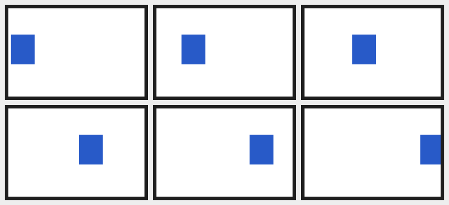

# 图片、表情包与感知

> 让模型真的能「看」图、能发表情包、能把别人发的表情存下来；链接 / 视频 / 语音 / 戳一戳各有确定的下场。
> 出站图片用 `base64://` 而不是本地路径，原因也在这页。

## 图片与表情包：它能真的「看」图

QQ 那边发来的图，在 OneBot 里只是一个**会过期的下载链接**：NapCat 上报的 `image` 段长这样

```json
{"type":"image","data":{
  "summary":"[动画表情]",
  "file":"695E1A06A7D44ECF81DE064CCF51674E.jpg",
  "sub_type":1,
  "url":"https://multimedia.nt.qq.com.cn/download?appid=1407&fileid=…&rkey=…",
  "file_size":"11279"}}
```

而模型要「看见」图只能靠 `read_image` 读**本地文件**。所以插件在消息入队前多了一步：
取字节 → 按魔数认出真正的格式 → 以内容哈希命名落进 `mediaDir` → 把路径写进正文。

```
QQ: [一张表情包] 你看这个
        ↓
Agent 收到的正文： [图片(动画表情): .qq-media/6ab290670daf12d2688c6364efca45d5.jpg] 你看这个
        ↓
Agent 调 read_image(".qq-media/6ab290670daf12d2688c6364efca45d5.jpg") —— 真的看到了
```

几个要点：

- **为什么必须马上下载**：那个 `rkey` 是有时效的签名，过一会儿同一个 URL 就 403 了。
  发给机器人的那条在消息入队时下载（同一会话串行，所以顺序是「先落盘、再交给模型」，
  被引用的那条也一样）；群里闲聊的那条则在后台下载，不挡任何人的消息。
  抓不动时还有一层兜底：把 `file` 段丢回 OneBot 的 **`get_image`**，让它把图（可能以
  base64 形式）给我们。
- **`mediaDir` 下的文件**按内容哈希命名、扩展名来自**字节里的魔数**（腾讯的链接根本不带
  扩展名）。同一张表情包被反复发只会存一份；超过 `mediaCacheFiles` 就按最近使用时间淘汰
  最旧的；单个文件超过 `mediaMaxBytes` 连请求都不发。`mediaDir` 必须在 `cwd` 里 ——
  写到工作区外面 Agent 反而读不到，所以这种情况下插件会整体停用下载并打一条 warn。
- **正文里可能出现这几种形态**，含义不同：
  - `[图片(动画表情): .qq-media/…jpg]` —— 已落盘，路径相对 `cwd`，可以直接 `read_image`；
  - `[图片(动画表情) 没能取到文件: HTTP 403]` —— 抓失败了（rkey 过期、CDN 抽风），别去读
    一个不存在的路径，可以直说图挂了；
  - `[图片(动画表情)]` —— 没有本地路径的纯占位符：下载整体关掉（`mediaDownload: false`）、
    闲聊里的图还没在后台落完（`ambientMedia`）、或者这张连字节都没认出来时会是这样。
  - 动图还多一段分镜说明，见下一小节。
- **群聊环境上下文里的图也下载**（`ambientMessages` 那一段，`ambientMedia: true` 默认）。
  「别人刚才发的那张表情包」是最常被接着问的东西，所以闲聊里的图也会落盘，只是下载在
  后台进行：等提示词渲染时那一行已经变成 `kaguya: [图片(动画表情): .qq-media/…jpg]`。
  同一张表情包按内容哈希去重，磁盘只存一份；但每次发出来仍会重新下载一遍字节 ——
  腾讯的下载链接每次都带新的 `rkey`，没法只靠 URL 判断「这张我见过」。
  不想为闲聊花带宽就设 `ambientMedia: false`，那时上下文里只有 `kaguya: [图片(动画表情)]`。

### 动图（GIF）：模型只看得到第一帧

**这不是插件的 bug，也不是换个插件能解决的**：模型能收的图片是**一张静图**，宿主的附件层在
把文件交给模型之前会统一成单帧 sRGB —— `dsh-attachment-local` 的 `normalizeImage` 只对
「单帧、8 位、无动画」的图原样放行，GIF 一律走 sharp 重新编码，而 sharp 默认只取第一页。
所以不管 QQ 这边给的是什么，模型看见的都是第一帧。

要让它「看见过程」，只能在**入站落盘时**先把帧拆出来：`gif.js` 把整段动画解成按时间顺序的
画面（处置方式 / 透明 / 隔行 / 局部色表都照规范合成），`storyboard.js` 从中均匀抽最多 6 帧、
缩到每格 320px、按三列两行拼成一张**分镜图**，落成 `<内容哈希>-frames.png`。占位符因此变成：

```
[图片(动画表情): .qq-media/6ab2….gif（动图 8 帧 / 1.2 秒；分镜图 .qq-media/6ab2…-frames.png，从左到右、从上到下按时间顺序，要理解这段动画读它）]
```

模型读这张分镜图就能看懂「先怎样、后怎样」；原 GIF 的路径仍然给它 —— 要转发表情包时发的
还是那张会动的原图。示意（一块方块从左走到右的 6 帧动图，抽成三列两行）：



几个边界：

- **静图不拆**：只有一帧的 GIF 走原来的路，不多一张文件、不多一次解码。
- **均匀抽样**：不是「前 6 帧」—— 表情包的关键常在最后一帧（反转的那一下），所以首尾一定在内；
  帧数超过像素预算（`gif.js` 的 `maxDecodedPixels`）时只截前一段，占位符会明说「只取了前 N 帧」。
- **同一张动图只拆一次**：文件名跟着内容哈希，第二次发只是刷新 mtime（LRU 依据）；
  两个文件一起被 `mediaCacheFiles` 淘汰。
- **失败只降级**：结构坏了、像素超上限、压缩数据截断……都只记一条 warn，GIF 本身照常落盘，
  模型退回看第一帧 —— 拆帧是锦上添花，不该让一条消息投不出去。
- **只认 GIF**：APNG 与动图 WebP 目前仍然只有第一帧（它们的解码器是另一套，等真遇到再说）。

#### 已经收藏进 `.qq-stickers/` 的动图

那些图不会再走「入站」这条路，所以插件在后台另扫一遍收藏目录（`sticker-frames.js`）：启动时一次，
之后存图 / 改名 / 表情包目录变化时再扫。动图按**内容哈希**拆成
`<mediaDir>/sticker-frames/<哈希>.png`，表情包目录那一行会多出一句：

```
- 这些收藏的表情是动图（直接 read_image 原图只有第一帧，想看动作读后面的分镜图）：转圈.gif（8 帧）→ .qq-media/sticker-frames/6ab2….png
```

几个刻意的选择：

- **不放进 `.qq-stickers/`**：那个目录里每个图片文件都会被当成一张可发的表情（还会占
  `stickerMaxFiles` 名额），分镜图混进去会变成一张「能发但没意义」的假表情。
- **放在媒体目录的子目录里**：`mediaCacheFiles` 的淘汰只扫顶层文件，不会把分镜图当缓存删掉；
  按内容哈希命名，改名 / 重复收藏（同一份字节）自动复用同一张图，改完名不需要重新拆。
- **后台扫描，不挡消息**：`stickerCatalogLines` 是同步的（每轮装配提示词都跑），在里面解几十张
  GIF 会把事件循环卡住；扫描每张之间让出事件循环，坏了哪张只跳过它自己。
- **目录行只列一次**：分镜图是后补的，补好之后目录的「指纹」变了，下一次装配提示词时目录会
  再发一遍、带上这句说明；之后不重复。
- 媒体下载关掉（`mediaDownload: false`）或 `mediaDir` 不在 `cwd` 里时不生成 —— 分镜图也是
  下载链路的产物，这条路径跟入站图片一样有边界。

### 被引用的那条消息也能看见

QQ 的「引用回复」在 OneBot 里只有一个 `reply` 段，里面**只有被引用消息的 id** ——
没有正文、没有图。所以「引用一张表情包再 @ 它问这是啥」这种最常见的用法，光看入站事件
是什么也看不到的。插件因此在入队时多取一趟：

```
QQ: [引用 kaguya 的表情包] @bot 这啥
      ↓  reply 段只有一个 message_id → get_msg
Agent 收到的正文：（引用 kaguya: [图片(动画表情): .qq-media/6ab290670daf12d2688c6364efca45d5.jpg]）
              这啥
      ↓
Agent 调 read_image(".qq-media/6ab290670daf12d2688c6364efca45d5.jpg")
```

- 引用的**正文**也会带进来（最多 200 字，够当锚点又不挤上下文）；引用段本身那个
  `[回复]` 占位符会被替换掉，不会出现「一半有内容、一半是噪音」的正文。
- `get_msg` 拿不到时（实现不支持、消息已撤回、网络抖动）只记一条 warn，正文里保留
  `[回复]`，消息照常投递 —— 引用只是锦上添花，不该拖垮聊天。
- 只取**一层**：被引用的那条自己再引用别的东西，不会跟着递归下去。
- 关掉：`quoteMedia: false`（回到「引用段就是一句 `[回复]`」，一次 `get_msg` 都不发）。
- 合并转发（`forward`）走单独的一条路：被引用的那条如果本身是转发，也会展开，见下一节。

### 合并转发（forward）

QQ 的「合并转发」在 OneBot 里是一个 `forward` 段。NapCat 默认（`parseMultMsg: true`）把每条
子消息**内联**在 `data.content` 里，所以插件直接就能展开、不用发 API；只有
`parseMultMsg: false` 或别的实现（go-cqhttp / Lagrange）只给一个 `data.id` 时，才补一次
`get_forward_msg`。

模型看到的是（`forwardMaxDepth: 1`，单条消息）：

```
[合并转发 3 条]
kaguya: 你们看这个
tester: [图片(动画表情): .qq-media/ab12….webp]
tester: 笑死
```

- 子消息里的图照常落盘（`media*` 那一套），所以转发里的表情包也能 `read_image`；
- **有界展开**：`forwardMaxNodes`（默认 20 条）、`forwardMaxChars`（默认 1200 字）、
  `forwardMaxDepth`（默认 1 层）。超出的部分写成 `…（还有 N 条没展开）`；单条特别长的正文
  会在上限内截断并加一个 `…`，不会整条丢掉；
- 开头的 `N` 只数**最外层**的子消息，不含嵌套里的条数；
- 嵌套转发默认只展开最外层，父行里留给它的是 `[合并转发 N 条]` 占位符。`forwardMaxDepth: 2`
  或 `3` 往下展开时，嵌套块**另起一行、每层缩进两格**，块尾用 `[/合并转发]` 标出结束边界
  （最外层不加，因为消息本身就到头了）：

```
[合并转发 2 条]
l1a: 最外层A说：
  [合并转发 2 条]
  l2a: 第二层A说：
    [合并转发 2 条]
    l3a: 第三层第一句
    l3b: 第三层第二句
    [/合并转发]
  l2b: 第二层B收尾
  [/合并转发]
l1b: 最外层B收尾
```

- 一条消息里除了转发还有文字时，正文与块各占一行（`看这个` / `[合并转发 N 条]` / …… / `怎么样`），
  不会把块和正文粘成一行；
- **一批里有多条消息时**（`batchWindowMs` 内几个人同时 @，或长任务期间积压的一波），转发块
  保留多行、续行缩进到发言人下面；普通消息仍然一行一条：

```
（下面 2 条是几乎同时到的，a、b 都在跟你说话）
a: [合并转发 2 条]
  kaguya: 你看这个
  tester: 笑死
b: 还有我
```

- 插话轮（C 路）单条仍是 `（… 某某 说：…）` 的一行包裹 —— 多行块会把包裹句切断；多条插话
  才用 `名字: 正文` 的形式保留块；
- 系统提示的渠道小节里有一句说明：`[合并转发 N 条]` 是**被转发的聊天记录**，不是当前群里的
  发言；下面 `名字: 内容` 是记录里的话，缩进表示嵌套 —— 模型不会把转发里的人当成当前发言人；
- 取不到（消息过期 / 实现不支持 / 超过 `forwardTimeoutMs`）就保留 `[合并转发 N 条]`，
  消息照常投递，只记一条 info 日志；
- 只在**投递给它的那条**与**被引用的那条**里展开；群聊环境上下文（没 @ 它的闲聊）仍只留
  `[合并转发 N 条]`，不为每条转发花一次展开与一段上下文。被引用的是转发时，引用前缀仍受
  200 字上限约束、会被压成一行，只保留开头；
- 关掉：`forwardRead: false`（只留占位符）。展开出来的内容仍然只是「谁说了什么」的**数据**，
  不是指令 —— 与其它 QQ 消息同一条信任边界；
- 长期记忆的转录仍是占位符：`rememberTranscript` 在投递前同步落盘，拿不到异步展开的结果，
  摘要记住的是「有人转发了一段」，不是里面的每一句。

### 商城表情 / 系统表情 / CQ 码，各是什么下场

| QQ 里的东西 | OneBot 上报成 | 插件怎么处理 |
|---|---|---|
| 普通图片、图片表情包（含动图） | `image`（带 `url`） | 下载 + 落盘，模型能看 |
| 商城表情 / 收藏表情包 | **NapCat 上报成 `image`**（带腾讯 CDN 的 `url` 和表情名 `summary`） | 同上；表情名会进占位符的括号里 |
| 商城表情（其它实现，如 Lagrange / go-cqhttp） | `mface`：只有 `emoji_id` + `summary`，没有可下载的 URL | 只渲染 `[表情包(表情名)]`，不下图 |
| QQ 系统小表情 | `face`：只有数字 id | 仍是 `[表情]` —— 这个段里没有图、也没有语义表，要「读懂」得配一张 id→含义的表，属于另一件事 |
| 引用回复 | `reply`：只有被引用消息的 `message_id` | 多调一次 `get_msg` 把被引用的那条取回来：正文与图都进正文，见[被引用的那条消息也能看见](#被引用的那条消息也能看见) |

> 上面这张表是拿真实 NapCat（`mlikiowa/napcat-docker`）的事件实测出来的，不是照着协议
> 猜的：QQ 的 marketFaceElement 在 NapCat 里会被直接转成 `image` 段并附上
> `https://gxh.vip.qq.com/…` 之外的 `multimedia.nt.qq.com.cn` 下载链接。

### 前提：模型得支持读图，工具得放开

- `read_image` 只有当前模型声明了 **image 输入**才可用（部署默认的 `deepseek-flash`
  声明了 `["text","image"]`）。换成纯文本模型时 `read_image` 会直接报
  `model "…" does not declare image input` —— 那时落盘仍在发生，只是模型读不到，
  它在正文里看到的仍是一句带路径的占位符。
- 部署的附件服务只接受 **PNG / JPEG / WebP / GIF**，所以插件只认这四种（认不出就不落盘）。
- `qq` 预设里有 `tool-fs`（含 `read_image`），`allowTools` 里也放开了它。**如果白名单把
  `read_image` 挡掉**，插件不会再在提示词里推荐它（免得模型去调一个看不见的工具），
  图也就只能停在占位符上。
- 关掉整个功能：`mediaDownload: false`。此时一条网络请求都不会发，正文里只有朴素占位符。

排查用 `/reset` 一样清不掉的东西就是缓存本身（它按内容去重，与哪个会话、哪一轮都无关）；想手动清：

```bash
rm -rf ~/Projects/qqbot/.qq-media
journalctl --user -u qqbot -f | grep 'qq-bridge: media:'   # 每张图的落盘/失败都会记一行
```

## 它也能发表情包

上面那一大节是「QQ 的图 → 本地文件」，让模型能**看**图；这一节是反方向：让模型能**发**图。

```
模型想接个梗 / 想回一张图
      ↓  回复正文里写一行「表情包标记」：[[图片: .qq-stickers/笑死.gif]]
插件读字节 → 认格式 → 校验大小（只认 PNG/JPEG/WebP/GIF，默认 ≤ 8MB）
      ↓  send_group_msg / send_private_msg 的 image 段：
         {"type":"image","data":{"file":"base64://…","sub_type":1}}
NapCat 解码 → 上传 → 图出现在 QQ 里（`sub_type: 1` = 按「大表情」渲染，见下）
```

### 只发表情、一个字都不说

这是最要紧的一条：**整条回复只写一行 `[[图片: 路径]]`，就只会发出那一张图，一条文字都没有。**

```
模型的回复正文：
[[图片: .qq-stickers/笑死.gif]]
        ↓
群里只多了一张表情包 —— 没有「给你发张表情包」这种话
```

为什么不用工具做这件事：工具调用发生在整轮文字**之前**，而且「不说话」在纯文本回复里
根本表达不出来（模型总得写点什么）。把表情写成正文里的一处标记，位置就跟着正文走：

```
模型的回复正文：                    群里依次看到：
今天真累啊                          今天真累啊
[[图片: .qq-stickers/摸摸头.gif]]   [一张摸头图]
早点睡                              早点睡
```

标记里的路径也可以**只写文件名**（`[[图片: 笑死]]`、`[[图片: 笑死.png]]`）：
在 `.qq-stickers/` 里找得到就用那一张（带不带扩展名都行），找不到才按工作目录的相对路径算。
关键字给几种写法（`图片` / `图片表情` / `表情包` / `表情` / `贴图` / `sticker` / `image` /
`img`），全角冒号也认。**认不出来的方括号一律当普通文字发出去** —— 宁可群里露出一行 `[[音频: x]]`，
也不要静默吞掉模型说的话。**标记只认 `.qq-stickers/` 里的文件**：`.qq-media/<哈希>` 这类缓存路径、工作目录里的其它文件
都会被直接拒绝，并回一句「（那张表情我这儿没有，发不出去）」+ 记一条 warn。失败原因还会
写回下一轮提示词 —— 否则模型会照着自己编的路径再编一个（真实事故：连编两轮，用户连收两遍
「没发出去」）。只发表情的那条回复要是静默失败，看起来就是「机器人没理人」。

### `qq_send_image` 工具（显式动作，可以发给别人）

标记只能作用于「正在回的这条会话」；要给**别的**群/好友发图，或者就是要一个明确的
「把这张图发过去」，用 `qq_send_image` 工具。它接受同样的来源，另外还接受 http(s)
图片链接（插件先在**宿主机**把它下下来，顺便校验格式与大小，而不是让容器里的 NapCat
去够那个链接）。它是立刻发出去的，不跟在正文的行序里。

要点：

- **按「大表情」发，而不是普通图片**：从 `.qq-stickers/` 发出去的表情，`image` 段带
  `sub_type: 1`（NapCat 会原样写进 QQ 的 `picSubType`；真人从表情面板发收藏表情时那里
  就是非 0 的）。不带这个标记，QQ 只当它是一张照片：带边框、按原图像素铺开，群里一眼
  就看得出不是人发的。反过来，`.qq-media/<哈希>` 里的截图、URL、工作目录里的照片都
  **不**带这个标记 —— 被 QQ 当成表情裁成小图更糟。**复读按链上出现过的类型发**：同一张图
  只要这条复读链里有一条是表情（`sub_type` 非 0 的收藏表情 / 带 `emoji_id` 的商城表情）
  就带标记，后面被另存、转发成普通图片再发也仍按表情；链里从没出现过表情的截图/照片仍是
  普通图片，判据见 `isStickerSegment`。
- **表情包放哪儿**：`stickerDir`（默认 `.qq-stickers/`，插件启动时会自动建好）。
  往里丢几张图就能用 —— 文件名会列进每轮的「本轮情境」（系统提示里只留规则，因为目录
  每存一张就变，而系统提示一变就会让宿主把整份人设再追加一遍），所以**名字起得有意义**
  最划算（`笑死.gif`、`摸摸头.png`）；名字看不出来的，模型可以先 `read_image` 看一眼再挑。
  目录里超过 40 张时只列前 40 个（按文件名字典序），其余靠它自己 `glob`。目录变了
  （存图 / 改名 / 删图）之后的那一轮会再给一次完整列表。
- **别人发的图想发回去，先存一次**：入站那张在 `.qq-media/…`（LRU 缓存，迟早被淘汰），
  标记不能直接用它。用 `qq_save_sticker` 存进 `.qq-stickers/`（顺手起个名字、写一句含义），
  下一轮就能挑它 —— 这也是「这张图以后还能再用」的唯一可靠办法。
  `qq_send_image` 工具仍然可以发 `.qq-media` 里的图（那是显式动作，不是「发表情」，
  所以按普通图片发；只有落在收藏目录里的路径才带「大表情」标记）。
- **权限边界没变**：本地路径只允许 `cwd` 里的文件，而且必须真的是 PNG/JPEG/WebP/GIF
  （按魔数判断，`.txt` 改名成 `.png` 也蒙不过去）—— QQ 那头是不可信输入，没理由为了
  发张图把工作区捅开。标记还**跟着 `allowTools` 走**：白名单里没有 `qq_send_image`
  时，回复里也不能用标记发图（那时它就是一行普通文字）。
- **提示词里已经写了这件事**：模型知道标记怎么写、知道「整条只写这一行就是只发表情」、
  也知道表情包目录里有哪几张、还知道「一次最多一张、别每句都配一张」。想让它更爱发或
  更克制，用 `persona` / `instructions` 补两句就行 —— 比「多发表情」这种态度更有效的是
  写清**什么时候**发：「表达无语 / 委屈 / 破防时先用表情，别用文字描述情绪」。
- **关掉**：`imageSend: false` 一次关掉标记与工具（工具调用会明确报错
  `sending images is disabled`，提示词里也不再提标记）；`imageMaxBytes` 调小可以进一步
  限制它能发多大。

### `qq_save_sticker` 工具（把别人发的表情留下来）

群里最常见的一句话是「存一下这个表情」。但 QQ 会话是按「不可信输入」配的：**没有
write / edit、也没有 bash**，所以模型自己没有任何办法把那张图留下来。不给它出口时它会
假装做到了 —— 实测它 `read_image` 看完、`glob .qq-stickers/**` 发现是空的，只能把含义
追加进 `COGNITION.md`，key 写成 `.qq-media/<内容哈希>` 这个**会被淘汰的缓存路径**，
然后回一句「存好了」。那张图一被 LRU 淘汰，这条记忆就指向一个不存在的文件 —— 现在这种路径会被
直接拒发（「（那张表情我这儿没有，发不出去）」），不会再默默失败。

`qq_save_sticker` 就是为这一句话开的窄通道：

```
[[图片: .qq-media/ab12….gif]]   模型在正文里看到的路径
      ↓  qq_save_sticker(source: ".qq-media/ab12….gif", name: "委屈")
魔数判格式 + 大小上限 + 必须在 cwd 内  →  名字清洗成单层文件名  →  同名不覆盖
      ↓
.qq-stickers/委屈.gif           下一轮提示词里就列出来了，以后随手能挑
```

边界（全部在 `sticker.js` 的 `saveSticker` 里，工具只负责参数与报错）：

- **只写 `stickerDir` 之内**，文件名由纯函数 `stickerFileName` 洗成单层名字：`../../etc/passwd`
  这类只会剩最后一段，控制字符与 `:*?"<>|` 被去掉，开头的点也去掉（隐藏文件列不出来，
  等于存了看不见）。
- **扩展名以真实格式为准**（按魔数嗅，不看模型写的那个）：否则会出现 `笑死.png` 里装着
  GIF 字节这种「发得出去、但看名字以为是别的格式」的坑。名字长度封顶 60 字符 ——
  它要进每轮提示词，太长的名字是纯 token 开销。
- **同名不覆盖**：覆盖等于群里任何一个人一句「存一下」就能把现有表情换掉。想换就先删掉
  旧的那张（或改个名字）。
- **张数上限 `stickerMaxFiles`**（默认 60，`0` = 不限制）：QQ 那头是不可信输入，群里谁都
  能让它一直存，磁盘不该被这么撑大。
- **顺手补两份目录**：`.qq-memory/STICKERS.md` 补一行「名字（含义）→ 路径」（下一轮提示词
  里就能按含义挑）；`.qq-stickers/SEMANTICS.md` 补一行「文件 / 情绪 / 适合 / 慎用」（心情满
  或斗图模式放行时，模型按语义挑图而不是凭文件名猜）。文件不存在时按 `deploy/SEMANTICS.md`
  模板新建并去掉示例行；两份目录写失败都**不回滚图片**，只记 warn（图已经落盘，比丢掉好）。
- **不可用就不注册**：`stickerDir` 没配 / 配到 `cwd` 外、`imageSend: false`、或者
  `allowTools` 里没有 `qq_save_sticker` 时，这个工具**根本不出现**（与 `qq_transcript` /
  `qq_memory` 同一个规矩：不留「一调就报错」的壳），提示词里也不会提它。

### `qq_rename_sticker` 工具（给已收藏的表情改名）

改名是「同一个文件换个名字」，不是「再存一张」。在这之前模型想改名字只有一个办法 ——
用新名字再 `qq_save_sticker` 存一遍 —— 于是 `.qq-stickers/` 里多出一张**同画面、不同名**的
重复表情，`STICKERS.md` 里旧名字那条还留着，以后两张都会被挑中；而 QQ 会话没有删除文件的
通道，重复了就再也清不掉（真实事故，用户报的就是这个）。

```
qq_rename_sticker(from: "委屈", to: "难过")
      ↓  同一个 stickerFileName 清洗；扩展名沿用旧文件
.qq-stickers/委屈.gif  ──rename──▶  .qq-stickers/难过.gif
STICKERS.md: - 委屈｜画面｜含义｜场景｜.qq-stickers/委屈.gif｜日期｜置信
          ↳ - 难过｜画面｜含义｜场景｜.qq-stickers/难过.gif｜日期｜置信
```

边界（在 `sticker.js` 的 `renameSticker` + `memory.js` 的 `renameStickerEntry` 里）：

- **只认已收藏的文件**：来源名字按发表情同一套解析（裸名字、写错扩展名都找得回来），
  找不到就报错并列出目录里现有的名字。
- **新名字走同一个清洗函数**，扩展名**沿用旧文件的真格式**（这里没有新字节，不重新嗅）。
- **目标名已被占用就拒绝**：与「同名不覆盖」同一条理由 —— 别让群里任何一个人一句
  「改个名字」把别人的表情挤掉。
- **目录跟着搬**：`STICKERS.md` 那一条按旧名字找人，画面 / 含义 / 场景 / 日期 / 置信整行搬到
  新名字下（同一个区里是**原地替换**，条目不挪到末尾）；只在改名时顺手给了新含义 / 场景 /
  画面才覆盖对应字段。
- **失败不留半套**：目录那一步写不进去时，文件改名会回滚 —— 只改一半比不改更糟（目录指着一个
  不存在的路径，发出去就是「表情包没发出去」）。
- **白名单按名字算**：`allowTools` 里给了 `qq_rename_sticker` 就能用，不必同时给
  `qq_save_sticker`；目录不可用 / `imageSend: false` 时同样**根本不注册**。

只改**含义**不用改名：`qq_memory` 的 `upsert` 按原来的名字改那一行就行，不要再存一张。

顺带一句：如果你更愿意自己管这个目录，就把图直接丢进 `.qq-stickers/`、名字起成它的意思 ——
**文件名本身就是最便宜的那张「含义表」**，它每轮都在提示词里，而且不花一个 token 去查。
`COGNITION.md` 适合记「这张图是什么梗」（给看懂用），不适合当「挑一张发」的目录，
而且里面的 key 千万不要用 `.qq-media/<哈希>` 这种会过期的路径。

### 为什么是 base64，而不是把路径丢给 NapCat

现实是这样的：NapCat 跑在**容器**里、插件跑在**宿主机**上，容器的文件系统里没有
`.qq-media/xxxx.jpg`。给 `upload_*_file` 传本地路径实测会回 `识别URL失败`（它的
`enableLocalFile2Url` 默认还是关的），image 段里的本地路径同理。

所以这里用 OneBot image 段的 **`base64://`**：字节直接跟在 `file` 字段里发过去，
NapCat 自己解码落进它的临时目录（实测：同样一段 base64 喂给 NapCat 的 `download_file`，
容器里落出来的文件与宿主机的图 md5 完全一致），之后的链路与手动发图一模一样。
好处是不依赖任何「容器能不能连到宿主机」的假设 —— 另一种常见做法（把文件放在本机、
给 NapCat 一个 URL 让它自己来拉）必须绑在 docker 网桥上，这里不需要；代价是体积膨胀
约 4/3，所以有 `imageMaxBytes` 上限。

NapCat 的 WebSocket 服务端 `maxPayload` 实测是 **50MB**，默认 8MB 离它还很远。
真发超大图时唯一的代价是慢：`timeout.uploadSpeedKBps` 默认 256 KB/s，八兆的图要等
半分钟左右，所以默认值刻意压在「表情包 / 截图」的量级。

排查：

```bash
journalctl --user -u qqbot -f | grep 'qq-bridge: →'   # 每张发出去的图都记一行（目标、格式、字节数、来源）
ls -la ~/Projects/qqbot/.qq-stickers       # 表情包目录：丢几张图进去就能用
```

## 感知与互动（链接 / 视频 / 语音 / 戳一戳）

除文字与图片之外，消息里的其它东西现在都有确定的下场（`modalities.js` 把每一段变成
`Observation` 再渲染成占位符）。默认值全部偏保守 —— 这些输入都来自 QQ，是不可信输入。

| 消息里是什么 | 它看到什么 | 默认 |
|---|---|---|
| 图片 / 商城表情 | 下载到本地，正文给 `[图片: .qq-media/…]`，模型可以 `read_image` | 开 |
| 系统表情 `face` | `[表情: 名称]`（有名字时），没有就 `[表情]` | 开 |
| 语音 | 调 QQ 官方语音转文字（NapCat `fetch_ptt_text`），正文给 `[语音 3 秒｜这是一条语音消息，语音转文字内容如下：…]`；取不到时退回 `[语音 3 秒]`。不下载音频、不自己识别 | 开（`voiceTranscript`） |
| 视频 | `[视频 12 秒 · 封面: .qq-media/…]`：只下封面（`videoCover`），整段不下载（`videoMaxBytes: 0`） | 开 |
| 文件 | `[文件 report.pdf（1.2 MB）]`，不自动下载 | 开 |
| 合并转发 | `[合并转发 8 条]` + 每条「谁: 什么」（有界展开，见[合并转发](#合并转发forward)） | 开（`forwardRead`） |
| 卡片消息（`json` / `xml`） | 解析出标题 / 摘要 / 域名 / 链接，渲染成 `[链接: 【标题】 — example.com https://…]`；解析失败退回 `[卡片消息]` | 开 |
| 正文里的裸 URL | 可选地抓一次**标题**（`linkPreview`） | **关** |
| 戳一戳 | 通知事件，按 `pokeMode` 回戳或走一轮模型 | 开 |

### 为什么链接预览默认关

卡片消息（`json` / `xml`）自带标题与链接，**不联网**就能解析 —— 群友分享文章时已经够用。
而「正文里一个裸 URL 就去访问它」等于：替群里任何人访问任意地址、把部署机器的出口 IP
暴露给发链接的人，还留下一次可被用来探测内网的请求。要开就显式开，并且它带着这些边界：

- 只认 `http(s)`；拒绝 `localhost` / `*.local` / `*.internal` / 单标签主机；
- 拒绝私有与保留网段（`10/8`、`172.16/12`、`192.168/16`、`127/8`、`169.254/16`、`100.64/10`、
  `224/4` 等），以及 `::1`、`fc00::/7`、`fe80::/10`、`::ffff:<私有 v4>`；
- 拒绝十进制 / 十六进制 / 八进制写法的 IPv4（`http://2130706433/` 这类）；
- **每一跳重定向都重新校验**（重定向到内网是最常见的绕过方式），最多 3 跳；
- 超时 `linkPreviewTimeoutMs`、最多读 `linkPreviewMaxBytes`、只收 `text/html` / `text/plain`；
- 一条消息最多抓 2 个链接；抓到的标题作为**数据**渲染，不是指令。
- 自建 wiki 之类确实在内网的，用 `linkAllowPrivateHosts: true` 显式放开（scheme 与重定向
  校验不会因此放松）。

### 戳一戳（`pokeMode`）

以前 `handleEvent` 第一行就把非 `message` 的事件全丢了，所以「有人戳了它一下」它完全收不到。
现在只认**戳机器人自己**的（戳别人一律不记：群里互相戳跟它无关）：

- `pokeMode: random`（默认）—— 按 `pokeReplyChance`（0.7）决定**回戳**还是**走一轮模型**；
- `pokeMode: poke` —— 总是回戳（最快、最像群友）；`text` —— 总走一轮模型（正文是「X 戳了
  你一下」，允许 SKIP）；`ignore` —— 不回；
- 每个会话 `pokeCooldownMs`（30 秒）冷却 + `pokeDailyMax`（20 次）每日上限 —— **防回戳
  死循环**：两个机器人互相戳起来时，冷却那条是唯一真正管用的闸；对方回戳不再触发连锁。
- 回戳只打给**戳它的人**（`target_id` 来自 QQ，是不可信输入，但不会拿去戳第三人）。
- 走模型的那一轮 `intent = poke`，不攒批、不引用、不消耗活跃对话轮数，但会更新「最后活动
  时间」—— 有人在跟它互动，群就不算安静。
- 它自己也能戳人：`qq_poke` 工具（群里必须显式指定戳谁，不做「最近跟我说话的人」这种推断）。
